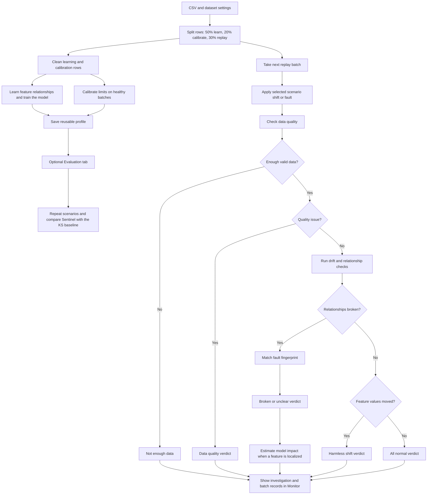

# How Invariant Sentinel works

This explains the whole method in plain language, with the few formulas that matter, then lists
the questions an examiner is likely to ask. Numbers are from the diamonds example.

## Pipeline at a glance

In short: setup learns a healthy reference once; each replay batch is checked against it and
gets a verdict. Open a batch in **Monitor** to see the explanation, charts, and the batch's rows.
The optional **Evaluation** tab repeats scenarios and compares Sentinel with the standard drift
check.

## 1. The problem in one example

A diamond wholesaler has a model that suggests a price for each stone from its weight, length,
width, depth, depth % and table %. Every day 200 stones are measured and priced.

- **Case A: holiday season.** Customers buy bigger stones. Every size feature moves up. A standard
  drift monitor compares today with the training data, sees four features change, and raises four
  alarms. Nothing is broken.
- **Case B: the length gauge reads 3% high.** A 5.7 mm stone is recorded as 5.87 mm. That is still
  a perfectly normal length, so a drift monitor on length alone barely notices (it caught this in
  1 of 30 days in our tests). But the model is now fed wrong data.

A standard monitor gets both cases wrong: it alarms when nothing is broken and stays quiet when
something is. Both cases are solved by one idea.

## 2. The central idea: watch relationships, not just values

Features of the same object are tied together. A stone's weight is set by its size: from healthy
data the system learns *weight grows like length^3.01*, which is just "volume goes with length
cubed".

- In **case A**, stones got bigger, but a bigger stone is still heavier in exactly the expected way.
  Values moved; relationships held. **Harmless.**
- In **case B**, the recorded length no longer matches the weight and width. Relationships broke.
  **Something is wrong, and it involves length.**

The key picture is the scatter plot *Does it still agree with its neighbours?*: the expected value
(from the other features) against the recorded value. A harmless shift slides points **along** the
diagonal; a fault pushes them **off** it.

## 3. The steps, in order

Every batch goes through the same five steps. The first matching verdict wins.

### Step 1: Quality checks (purple verdict)

Invalid data should be called invalid, not drift. Before anything else, each feature is checked for:

- **missing**: more than 20% of values missing;
- **out of range**: more than 5% of values outside the plausible range seen in healthy data (this
  catches unit errors like millimetres recorded as centimetres);
- **stuck**: the spread within the batch is under 1% of the usual spread (a frozen sensor).

A failing feature is set aside ("masked") so it cannot pollute the other checks. A few individually
impossible values are simply removed and noted.

### Step 2: The standard drift check (supporting evidence)

For each feature, the **KS statistic**: the largest gap between the cumulative distribution of
today's values and of the reference values. 0 means identical, 1 means no overlap.

The alarm limit is not a textbook p-value. It is **calibrated**: the system replays 800 healthy
batches and takes a high percentile of the KS values they produce. With six features, the 1% false
alarm budget is split across them. This same check, alone, is the baseline we compare against.

### Step 3: Learn and test relationships (the core)

**Learning (once, from healthy data).** For each feature, a small linear rule predicts it from at
most three other features, chosen greedily: add the feature that improves the fit most, stop when
the gain is tiny. Size features use a log scale, so multiplicative laws become straight lines:

    log(weight) ≈ −5.60 + 3.01 × log(length)

A rule is used only if it explains at least half of the variation (R² ≥ 0.5) on separate
calibration data. On diamonds, five of six rules pass; the table % rule (R² 29%) is too weak.

**Testing (every batch).** For each rule, the error of each row, divided by the rule's usual error:

    e = (recorded − predicted) / usual error

- **Shift score** z = mean(e) × √n. If the errors moved together in one direction, the rule broke.
- **Scatter** = today's spread of e ÷ usual spread. If the errors got noisier, a sensor got noisy.

Limits are again calibrated on healthy batches: the 99.5th percentile of the *largest* shift score
across all rules (6.07 on diamonds), so the false alarm rate is controlled for all rules at once.
The scatter limit has a floor of 1.5, because natural shifts slightly change the scatter.

### Step 4: Which feature? Fingerprint matching (red or amber verdict)

If feature *j* reads too high by an amount *d*, we know in advance how each rule's errors should
move:

- a rule that **predicts j** sees its errors go **up** (recorded value higher than predicted);
- a rule that **uses j as an input** sees its errors go **down** by the rule's coefficient
  (prediction goes up);
- a rule that does not involve j does not move.

This pattern is feature j's **fingerprint** (the column S_j of the signature matrix). We observe the
actual pattern v of error shifts, and for each candidate feature ask how much of v a fault on that
feature alone explains:

    d_j = (S_j · v) / (S_j · S_j)                 best-fitting fault size
    E_j = 1 − |v − d_j S_j|² / |v|²               share of the pattern explained (0 to 1)

- If the best candidate explains at least 70% **and** beats the runner-up by at least 20 points:
  **red, broken relationship**, with that feature named.
- Otherwise: **amber, unclear**, listing the candidates. The system prefers "I cannot tell" to a
  confident wrong answer.
- The sign of d says "reads high" or "reads low", and its size gives "about 3.1% too high".

The same matching works for noisy sensors, using variances instead of means.

**Knowing the limits in advance.** Two features whose fingerprints point in almost the same
direction (cosine similarity above 0.95) can never be told apart. This is computed once, before
any monitoring, and shown on the Relationships page. It is an honest statement of capability.

### Step 5: Does the model care?

For the suspect, replace its values with what its rule says they should be, run the price model
again, and compare:

    impact = mean |price(recorded) − price(repaired)| ÷ model's usual error

The repair is itself imperfect, so the impact is called **material** only if it is above 0.25 and
above what repairing produces on healthy batches (95th percentile). This needs no true prices.
When true prices arrive later, the app shows whether the repaired inputs really give a lower error.

### Verdict summary

| Verdict | Colour | Meaning |
|---|---|---|
| Data quality issue | purple | a feature is invalid (missing, wrong unit, stuck) |
| Not enough data | hatched | too few valid rows to judge |
| Broken relationship | red | relationships broke and one feature clearly explains it |
| Unclear | amber | relationships broke but several features could explain it, or a feature moved that no rule can vouch for |
| Harmless shift | blue | values moved, every relationship holds |
| All normal | grey | nothing moved, nothing broke |

## 4. Data used for what

The data is split once: **50%** to learn the rules and train the model, **20%** to calibrate every
limit, **30%** kept aside and replayed as "days". Obvious garbage (missing values, impossible
zero sizes, the most extreme 0.1% at each end) is removed from the learning and calibration parts.

**Harmless shifts are simulated honestly.** Real rows are re-sampled, favouring larger stones.
Whole real rows are kept, so every true relationship inside a row stays true while the values move.
**Faults** are simple formulas applied to real rows (×1.03, +1 mm, added noise, frozen value,
missing values, ×0.1 for a unit change) and are logged, so the ground truth can be revealed.

## 5. Results (diamonds, 30 batches per situation)

| Situation | Sentinel | Standard drift check |
|---|---|---|
| Ordinary days: false alarms | 0% | 0% |
| Harmless shift, strength 0.5 / 1 / 1.5: false alarms | 0% / 0% / 20% | 100% / 100% / 100% |
| Weight 6% high: caught / right feature | 100% / 100% | 60% / 57% |
| Length 1% high: caught / right feature | 100% / 100% | 3% / 3% |
| Width 1% high: caught / right feature | 100% / 100% | 3% / 3% |
| Depth 2% high: caught / right feature | 100% / 0% (always "unclear") | 3% / 3% |
| Depth % +0.6 points: caught / right feature | 100% / 0% (always "unclear") | 100% / 100% |
| Table % +1 point: caught / right feature | 90% / 90% | 90% / 90% |
| Weight recorded in another unit: called a quality issue | 100% | 0% (it alarms, but calls it drift) |

What to say about the weak rows:

- **Depth and Depth %** are reported as unclear because their fingerprints are similar (Depth % is
  itself computed from depth, length and width). The system does not guess; it names the candidates.
- **Table %** has no usable rule, so Sentinel can only do what the standard check does. It says so
  ("no relationship can confirm this change is harmless").
- **Strong shifts (1.5)** give 20% false alarms. The likely reason is that very large stones are rare
  in the training data, so the rules are least accurate there. Still far below 100%, and reported
  rather than hidden.

On abalone the harmless-shift result is the same (0–17% vs 100%), all faults are caught, but length
vs diameter and the four weights have near-identical fingerprints, so most faults there are
correctly reported as unclear between a small group. The dataset decides how well faults can be
located, and the app shows this before monitoring starts.

## 6. Limitations (say these before you are asked)

- **Faults that hit every feature at once** (a firmware update adding 1% to every measurement) keep
  the relationships intact, so they look like a harmless shift. Only the drift check or the model's
  error would reveal them.
- **Features need to be related.** With unrelated columns, rules are weak and the system is no
  better than a standard drift check.
- **Linear rules.** Log scales handle multiplicative laws, but curved relationships are approximated.
- **One fault at a time.** Two simultaneous faults usually produce "unclear", which is honest but
  not a diagnosis.
- **Noisy relationships.** A rule that predicts a feature from its own *effects* (for example
  predicting a cause from things it drives) is only approximately stable when the data is noisy, so
  a strong real shift can occasionally break it. The tests on synthetic data show this.
- **Simulated faults are idealised**: clean start, exact formulas. Real faults are messier.
- **"Root cause" means statistical localisation**: the feature whose single fault best explains the
  pattern, not proven causation.
- **After a genuine permanent change** the profile must be rebuilt (Your data → Rebuild).

## 7. Likely viva questions

**What problem do you solve?** Drift monitors say *that* data changed. They cannot say whether the
change is harmless or a fault, which feature is at fault, or whether the model is affected. We
address all three.

**Contribution in one sentence?** We learn relationships between features from healthy data and use
the pattern of broken relationships to separate harmless shifts from faults and to name the faulty
feature, with an estimate of the impact on the model that needs no labels.

**Isn't this just correlation monitoring?** No. Each rule is a small predictive model with
coefficients, and the coefficients give each feature an exact, signed fingerprint. Finding the
faulty feature is then a matching problem that can also answer "unclear".

**Where does the idea come from?** Fault detection and isolation in control engineering, known as
analytical redundancy and structured residuals (Gertler; Isermann). We adapt it to ML input
monitoring and compare it against a standard drift check. We do not claim to have invented it.

**Why this dataset?** Anyone understands diamonds in ten seconds, the relationships are almost
physical laws, a harmless shift has a natural story, and it has true prices to check the impact.

**Why log scale for sizes?** Weight goes with length × width × depth. Taking logs turns that product
into a sum, so a linear rule fits almost perfectly (R² above 99%), and a 3% gauge error becomes a
constant shift of the same size for every stone.

**Why at most three inputs per rule?** If every rule used every feature, every fault would disturb
every rule and all fingerprints would look the same. Sparse rules give distinct fingerprints.

**Why not use KS p-values directly?** They assume ideal conditions and ignore that six features are
tested at once. We calibrate every limit on 800 replayed healthy batches instead, so the false alarm
rate is measured, not assumed.

**How do you know a shift is harmless?** Values moved beyond their calibrated limit, but every
relationship stayed within its calibrated limit. If rows also fall outside what the model saw in
training, the explanation warns that the model is working in unfamiliar territory.

**Can a harmless shift still hurt the model?** Yes, if the new values are outside the training range.
That is why we report the share of unfamiliar rows and show the model's real error once known.

**Explain the fault matching mathematically.** Each feature has a fingerprint column S_j. We
project the observed pattern v onto it: d_j = S_j·v / S_j·S_j, then E_j = 1 − |v − d_j S_j|² / |v|².
The feature with the highest E_j is the suspect if E ≥ 0.7 and it beats the runner-up by 0.2.

**Why does Depth come out unclear?** Its fingerprint is 91% similar to Depth %'s, because Depth % is
computed from depth. The app shows this on the Relationships page before monitoring starts.

**What if two faults happen at once?** No single fingerprint fits, so the verdict is unclear rather
than a confident wrong answer.

**What can it not detect?** Faults that shift every feature together, faults on features without a
usable rule, and faults smaller than the rules' normal error.

**How do you estimate impact without labels?** Replace the suspect with the value its neighbours
predict, re-run the model, compare the change with the model's usual error, and discount the
change the repair causes on healthy data.

**Why quality checks before drift?** A unit bug would otherwise look like massive drift on one
feature and break every rule that uses it, contaminating the diagnosis. Masking it first keeps the
other checks clean.

**Is the comparison fair?** The standard check uses exactly the same calibrated limits, so any
difference comes from the relationships, not from better thresholds.

**Isn't the simulated shift too easy?** Partly: re-sampling only reweights real rows. That is also
its strength: every relationship inside a row is real. Stronger shifts (1.5) already show the method
starting to bend, and we report it.

**Why not Evidently or NannyML?** They are good standard drift tools; using them would replace
exactly the part we are contributing.

**Does it work on other datasets?** Yes, if features are related. The code never mentions diamonds;
each dataset is a small JSON settings file, and any CSV can be uploaded from the app.

## 8. Threshold registry

All thresholds are shown in the app (Relationships page) with their source.

| Threshold | Value | Source |
|---|---|---|
| Missing share for a quality issue | 20% | heuristic |
| Out-of-range share for a quality issue | 5% | heuristic, range from healthy data |
| Stuck: spread below | 1% of usual | heuristic |
| Rule usable if R² at least | 0.5 | heuristic |
| Shift score limit | 99.5th percentile of largest score on healthy batches | calibrated |
| Scatter limit | 99.5th percentile, at least 1.5 | calibrated with floor |
| KS limit per feature | healthy percentile, 1% split across features | calibrated |
| Unfamiliar rows share | 99th percentile | calibrated |
| Suspect explains at least / beats runner-up by | 70% / 20 points | heuristic |
| Same fingerprint above | 0.95 cosine | heuristic |
| Material impact | 0.25 and above healthy 95th percentile | heuristic + calibrated |
